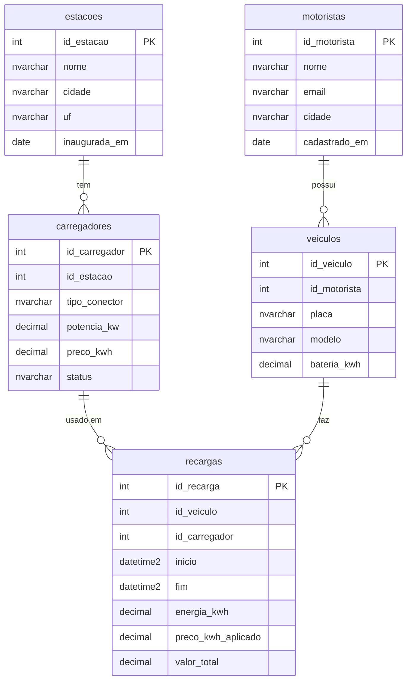

# Prática T-SQL: rede de recarga de carros elétricos

Prática da trilha T-SQL do Ensina Dados (Prof. Well). Você vai pegar uma base **crua e cheia de problemas**, descobrir a sujeira, limpar, montar um tabelão e analisar. É o caminho de uma pessoa de Engenharia de Dados: do dado normalizado (5 tabelas) para o desnormalizado (um tabelão pronto para análise).

> **Dados fictícios.** Nomes, e-mails, placas, modelos, potências e preços foram inventados só para esta prática. Não representam pessoas, empresas ou fatos reais.

## Pré-requisito

Um banco **Azure SQL Database** criado nas aulas 2 e 3 da trilha, e acesso ao **Query editor** do portal do Azure (menu do banco, "Query editor"). Tudo é feito lá, sem instalar nada.

## Como usar

1. No portal, abra o Query editor do seu banco.
2. Cole e execute `ambiente/01-criar-tabelas.sql`, depois `ambiente/02-carga-dados.sql`. Isso monta o ambiente. É o único código pronto.
3. Siga os blocos na ordem, de `exercicios/bloco-01-...` a `bloco-08-...`. Cada exercício diz **o que fazer**, **por quê**, uma **dica** e um **"Confira:"** com números para você validar sozinho.
4. Escreva você mesmo o SQL. Só abra `solucoes/` depois de tentar. As soluções são uma das formas de resolver, não a única.
5. Se bagunçar a base, rode `01` e `02` de novo: eles recriam tudo do zero. (Os objetos dos blocos 06 a 08 você recria pelos exercícios.)

Avisos do Query editor (fonte: Microsoft Learn, "Azure portal query editor"):

- Se o script tem vários comandos, a aba de resultados mostra **só o resultado do último**. Rode **um comando por vez** (selecione o trecho e execute) para ver cada resultado.
- Há limite de 5 minutos por execução.
- Ao atualizar a página (F5) ou fechar o navegador, o que você digitou se perde. Guarde seus scripts em um arquivo.

Os arquivos `ambiente/` rodam sem `USE` e sem `GO`. **A conferir no Azure:** o `02` é grande (cerca de 100 KB); se o editor travar ao colar, rode tabela por tabela (cada bloco `DELETE` + `INSERT` é independente).

## Modelo das 5 tabelas



As linhas do diagrama são relações **lógicas**. No banco elas **não existem**: não há chave estrangeira. Só há chave primária.

## Por que a base é crua de propósito

Os scripts de `ambiente/` criam as tabelas só com a chave primária: sem `FOREIGN KEY`, `NOT NULL`, `CHECK`, `UNIQUE` ou `DEFAULT`. E a carga traz dados sujos: cidades escritas de vários jeitos, motoristas duplicados, recargas com data de fim antes do início, valores negativos, recargas de veículos que não existem e mais. Em projetos reais o dado chega assim.

O caminho da prática:

```
base crua (5 tabelas) -> explorar -> JOINs -> limpar -> tabelão (com constraints) -> análises -> automatizar e proteger
      normalizado                                          desnormalizado
```

Atenção: **nem todo NULL é erro.** Uma recarga em andamento ainda não tem fim, energia nem valor. Aprender a separar o que é sujeira do que é dado legítimo faz parte da prática.

## Blocos

| Bloco | Tema | Exercícios |
|---|---|---|
| [01](exercicios/bloco-01-ambiente.md) | Ambiente: criar e inspecionar a estrutura | 7 |
| [02](exercicios/bloco-02-carga.md) | Carga: rodar o 02 e contar linhas | 5 |
| [03](exercicios/bloco-03-exploracao.md) | Validação e exploração: descobrir a sujeira | 8 |
| [04](exercicios/bloco-04-joins.md) | JOINs de 2 a 5 tabelas, LEFT JOIN, órfãs | 8 |
| [05](exercicios/bloco-05-limpeza.md) | Limpeza com UPDATE/DELETE em transação | 8 |
| [06](exercicios/bloco-06-tabelao.md) | Tabelão com constraints (normalizado para desnormalizado) | 8 |
| [07](exercicios/bloco-07-analise.md) | Análise: filtros, agregações, HAVING, CASE | 8 |
| [08](exercicios/bloco-08-fecho.md) | Fecho: procedure, trigger e permissões | 8 |

Depois: desafio de fixação (em breve).

## Estrutura da pasta

```
ambiente/     scripts prontos: 01 (criar tabelas) e 02 (carregar dados)
exercicios/   enunciados, sem a resposta
solucoes/     SQL comentado de cada exercício (abra depois de tentar)
```
